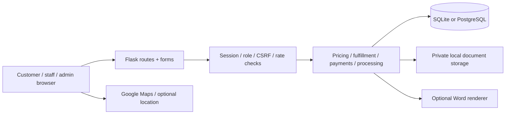

# Prints On Demand: technical and operational breakdown

Reviewed 19 October 2026 against application commit `03fc6da`. This describes the
repository implementation, not a certification of the live server. The user’s
PythonAnywhere terminal confirmed that `/home/Decimo/PrintsOnDemand` pulled through
`8e15d88` and applied migrations through `d82f1b70a631` using SQLite. A successful
Web reload and the host’s current environment/settings have not been inspected.
Commit `03fc6da` changes the README only.

The latest completed application test run passed 549 tests, including six optional
PostgreSQL policy integration tests run against PGlite PostgreSQL 18.6. Those are
automated regression results, not a penetration-test or live-deployment guarantee.

## 1. Product boundary and architecture

The app is a campus printing-order portal. It records requests and human actions;
it does not control printers, transfer money, book couriers, or electronically
deliver files to professors. Students and professors order; assigned shop staff
produce the jobs and manage their shop; administrators manage supported global
resources. Blue and Silver has additional professor-management permissions.

Python 3.12/Flask provides a server-rendered application using Jinja, vanilla
JavaScript, and CSS. SQLAlchemy handles relational data, Flask-Migrate/Alembic
schema changes, Flask-Login identity, Flask-WTF/WTForms forms and CSRF, Werkzeug
password hashing, Pillow image processing, and pypdf PDF inspection. SQLite is the
current hosted backend; PostgreSQL is supported with additional row policies.
Gunicorn is available for Linux deployments; PythonAnywhere supplies its WSGI host.

`create_app()` loads configuration, initializes extensions/security, registers
blueprints and CLI commands, and installs error handlers/headers. `run.py` is the
development/CLI entry point and `wsgi.py` exports the hosted app. Routes select
records and render responses; service modules implement pricing, fulfillment,
payment decisions, processing, professors, deletion, and backups. The storage
interface separates document bytes from relational metadata.

There is no separate SPA, public REST API contract, background task queue,
WebSocket update channel, or printer integration. A checkout upload route can
return JSON for the existing browser upload experience. Most mutations are HTML
form POSTs, followed by redirects.



`/health` returns a static JSON `status: ok`; it is process liveness, not a
database/storage/converter/backup readiness test. Google Maps and Google Fonts
are external browser dependencies. No external payment-processing provider or
mail/SMS delivery provider is connected by the app.

## 2. Roles and authorization

| Actor | Implemented access |
|---|---|
| Anonymous | Landing page, health response, registration/login forms, public static assets and shop-photo endpoint |
| Student | Own workspace/account/files/orders, shop discovery, checkout, eligible professor selection, own completion |
| Professor | Own workspace/account/files/orders, shop discovery, checkout, eligible self-delivery to Faculty |
| Shop staff | Own shop dashboard, settings, order files/progress, payment review; shop assignment required for shop operations |
| Blue and Silver staff | Staff permissions plus professor verification, approval management, and supported professor deletion |
| Administrator | Admin dashboard, shop CRUD/settings, staff assignments, global supported payment review and legacy payment settings |

The role guard requires login then checks the allowed role, returning 403 for an
authenticated wrong role. Private queries also filter by customer owner or staff
shop, commonly returning 404 for inaccessible objects. Knowing a reference or ID
is not sufficient authorization. The bounded integer URL converter rejects
nonpositive or greater-than-signed-64-bit IDs.

Administrator status does not automatically grant Blue and Silver professor-page
access or the shop-staff production screens. Database administrator read policies
also do not create extra web routes. Staff/admin accounts are not available through
public registration. Trusted-shell provisioning and assignment are separate.

## 3. Registration, login, and account lifecycle

The landing page offers Log in and a combined Sign up. Default registration does
not preselect an account type; recognized `account_type` query parameters still
support explicit preselection. Names are 2–120 characters, emails at most 254,
passwords 10–128, and confirmation must match. Emails are normalized and unique.
Public signup permits STUDENT or PROFESSOR only. Email syntax validation is not
email ownership verification or institutional-domain enforcement.

Professor registration requires a valid department and an appropriate faculty
selection when that department has choices. Student requests cannot submit a
faculty as if they were professors. Registration creates a professor account in
the verification workflow; it does not automatically approve delivery.

Ordinary login accepts customer/admin credentials; dedicated shop login supports
the implemented staff identifiers, including legacy Blue staff name login.
Successful authentication redirects to the role workspace or a validated local
`next` path. External, protocol-relative, backslash-containing, and unsafe redirect
targets are rejected. Unknown users incur a dummy password-hash verification;
failure responses avoid exposing credential validity through different messages.

The customer account page displays identity and applicable professor information.
It is not a full profile/password-reset console. The former professor preference
POST returns 404; staff manage delivery acceptance. The legacy professor settings
route remains in the route inventory. Account deletion requires the customer’s
current password, confirmation, and CSRF. It removes the owned order/payment/file
graph and login, not shared shops or other customers’ historical snapshots.

There is no public forgot-password/reset-email flow, MFA, email verification,
social login, session/device management screen, or self-service staff registration.

## 4. Professor directory, faculty choices, and physical delivery

Blue and Silver verifies pending accounts or rejects them. Verification creates or
associates the managed profile in the same transaction and copies account name,
email, department, faculty, and assigned office/location. Staff then control three
approval switches: active, approved for Direct-to-Professor, and accepts student
print deliveries. Fresh verified profiles start with delivery approval and student
acceptance off. Verification is not itself delivery approval.

| Department | New-registration faculty choices |
|---|---|
| MITL | Chemical Engineering; Civil Engineering; Industrial Engineering; Architecture; Computer Engineering; Electronics Engineering; Mechanical Engineering; Electrical Engineering |
| ETYCB | Hospitality Management; Business Administration; Global Management; Business Intelligence and Analytics; BS Marketing; Tourism Management; Accountancy; Accounting Information Systems; Business Program Chair |
| CHS | Biology; Psychology |
| CCIS | Information Technology; Computer Science |
| CAS | Multimedia Arts; Communication |
| CMET | Marine Engineering; Marine Transportation |
| SHS | No faculty selector |

GE and IECELL are excluded from new choices. Legacy code values remain accepted
internally for existing data compatibility; removing signup choices does not erase
old records.

| Department | Physical delivery destination |
|---|---|
| MITL, CMET | Einstein Building 1st Floor |
| CCIS | Einstein Building 3rd Floor |
| CAS, ETYCB, CHS | Einstein Building 4th Floor |
| SHS | Rizal Building |

A student recipient must have an active, verified account linked to an active,
approved profile that accepts student deliveries and has a supported faculty.
Professor self-delivery requires verified/active/approved eligibility and a valid
faculty but does not require student-delivery acceptance. Self-delivery recipients
derive from the signed-in account; customers cannot override the identity/faculty.
The shop must be the active Blue and Silver Bookstore with its professor service
enabled. This rule depends on the shop name string, so renaming it can affect access
and eligibility.

Orders snapshot recipient name, email, department, faculty, office, and recipient
type. Subsequent account/profile changes do not rewrite those historical details.
There is no email attachment delivery. Physical handoff is recorded by staff.
The old Add professor route returns 404; normal profiles originate from verified
accounts. Unlinked legacy profile deletion remains separately supported.

## 5. Shop discovery and customer UI

Authenticated customers can search active shops by name, browse List View, switch
to Google Maps View, select markers, inspect details, and read services/rates/fees.
Search is length-limited and SQL wildcard characters are escaped. The map payload
includes only active shops with stored valid coordinates. A shop without coordinates
can still exist in the directory without appearing as a map marker.

Displayed map ratings are configured constants: Blue and Silver 4.0, Iced Design
and Prints 4.5, CHALECOSPOT 4.0, Pixels Print and Press 5.0. They are not calculated
from customer submissions, and there is no review moderation system. Removed
sample labels do not independently verify the correctness of business rates.

Google Maps requires browser API configuration and external service availability.
The browser key is intentionally client-visible; provider API/referrer/quota
restrictions must be configured outside the app. Location sharing is optional,
browser-permission driven, and not a continuous courier/location-tracking feature.

The frontend includes responsive navigation, checkout progress, cards/tables,
status badges, service/payment/approval switches, password visibility controls,
and form feedback. Native page transitions enhance list/map and staff section
navigation where supported; customer Start Order/Order History/Account navigation
explicitly skips the pushing transition. Reduced-motion handling and normal links
provide fallbacks. These implementation details do not establish WCAG conformance
or complete browser/device visual testing.

## 6. Uploads, private storage, and document handling

The allowlist is PDF, DOC, DOCX, PPT, PPTX, JPG, JPEG, PNG. Other extensions cannot
be enabled simply by changing an environment value. Each file is capped at
26,214,400 bytes (25 MiB), configurable downward. The entire request is capped at
the configured file size plus 64 KiB, so twenty 25 MiB files cannot be sent in a
single request. A checkout may contain up to twenty distinct files accumulated
through valid uploads. Default copies per file are bounded at 999.

Validation rejects folder paths and invalid/overlong filenames, normalizes names,
checks extension and declared MIME, reads at most the limit plus one byte, checks
nonempty content and signatures, and records SHA-256. Generic/absent MIME is
accepted only alongside the other checks. DOC/PPT use the OLE signature. DOCX/PPTX
must have expected ZIP members and content type, reject `vbaProject.bin`, and limit
the inspected content-types member. This does not fully validate every embedded
object, decompress every member, or provide antivirus/content disarm.

PDFs are parsed strictly and encrypted, invalid, or empty PDFs are rejected.
Word documents are rendered temporarily through detected LibreOffice/AbiWord (or
configured converter path), then page-counted from PDF output. Conversion uses
isolated temporary directories and a 30-second timeout per attempt. Rendering
depends on installed software/fonts and is not an OS/container sandbox. If accurate
Word pages are unavailable, quoting asks for a PDF rather than silently charging
one page. Existing stored Word counts greater than one may be reused; PDFs are
recounted. Images and PowerPoint files currently have no page/slide count and use
copy count as billable units.

Document bytes use random storage keys under a private root, default
`instance/uploads`; metadata is in SQL. Root/key/path validation prevents normal
traversal and public-static placement. Owner and attached-order staff downloads
use authorization, attachment responses, no-store headers, and nosniff. Shop
photos/QR images are separate image-processing paths, not document upload types.

Checkout uploads are staged with a timestamp; drafts can use only fresh, owned,
unattached staged files. Default abandoned retention is 24 hours. Removing a file
from checkout is not an immediate guaranteed byte purge; cleanup expires abandoned
data. Placement clears staging status. Cleanup excludes legacy unstaged files and
order attachments. File-library routes remain available separately; an attached
file cannot be deleted individually, and historical print settings stay in items.

Local storage is the only implemented backend. The strict production profile
refuses it for uploads until a durable adapter exists. Reserving object-storage
environment names does not implement that adapter. No per-user aggregate storage
quota, automatic expiry of completed orders, or universal file-malware scan is
implemented.

## 7. Checkout, pricing, and transaction behavior

Private-path access control is not encryption at rest: ordinary local documents
and SQLite data are not encrypted by this storage implementation. Encrypted backup
archives are a separate control. Host disk encryption and PostgreSQL transport
encryption depend on provider/connection configuration and are not established by
the presence of password hashes or RLS.

The primary flow is Upload → Shop/print settings → Fulfillment → Payment → Review
→ Placement → Success. The draft lives in the signed Flask session and is tied to
the current customer ID; it is not a server-side persistent cart or encrypted
vault. Login clears anonymous/prior state. Session signing prevents undetected
client changes, but signed session payloads are readable by the client. File bytes
are never put in the session.

The backend reloads owned files, active shop, current rates, valid enums, quantity,
services, fulfillment, and payment eligibility. Client-supplied totals are not
trusted. The quote fingerprint includes relevant file/configuration/rate/total
details. Changed review state causes a 409/review requirement. File size/hash and
countable document pages are rechecked before placement. This is not a promise of
serializable price locking against every simultaneous configuration change.

Paper sizes are LETTER, LEGAL, A4, A3, A2; color is GRAYSCALE or COLOR. A missing or
zero rate means that combination cannot be ordered. Monetary values use Decimal
and two-decimal checks, with nonnegative/range validation.

```text
billable units = document pages × copies, when page count is known
                 copies, when no page count is implemented
line total     = current shop paper/color rate × billable units
subtotal       = sum of line totals
rush fee       = PHP 20 once if any item is rush, otherwise PHP 0
fees total     = rush fee + applicable saved delivery fee
order total    = subtotal + fees total
```

The current rush charge is fixed in the pricing service at PHP 20, even though the
schema contains shop-fee records. Do not describe rush as percentage-based or
freely configurable through every existing fee record. Rush also requires the
shop’s enabled rush service. Duplicate file IDs and excessive item counts fail.

Placement creates the order, item snapshots, applicable fulfillment snapshots,
and initial payment atomically. References use `POD-<year>-<12 uppercase hex>`
with database uniqueness and retry on rare collisions. They are identifiers, not
authorization secrets. Successful placement clears the draft and retains the last
reference for browser retry handling. The primary flow avoids a repeated success
creating another order, but it does not offer a general cross-device idempotency
key API. Legacy `/orders/new` and `/orders/create` flows still exist.

## 8. Fulfillment and scheduling rules

Pickup requires the enabled pickup service and available operating-hour slots.
Delivery requires enabled delivery, available slots, valid recipient name/phone/
address, and a valid configured delivery fee. Professor delivery requires the
separate eligibility checks described above. Values belonging to another selected
method cannot be used to override fulfillment fees or recipients.

Pickup and regular delivery default to zero lead days and a thirty-day future
window. Dates are validated against Asia/Manila today, not a hardcoded calendar
date. Slots start at opening time and align subsequent boundaries to clock hours,
end by closing time, and omit fragments shorter than thirty minutes. Invalid or
out-of-hours submitted slots fail server validation. Current slot validation does
not compare today’s requested slot to the current clock time; it also does not
implement holiday calendars, capacity limits, or overnight-hours scheduling.

These are requested fulfillment dates/times. There is no courier dispatch API,
appointment reservation capacity system, automatic SMS, ETA promise, or electronic
proof-of-delivery upload. Professor handoff has a staff-recorded timestamp.

## 9. Payments and exact order state transitions

Payment methods are ONLINE and ONSITE. Payment statuses are PENDING, SUBMITTED,
PAID, REJECTED. Order statuses are PENDING_PAYMENT, PROCESSING, READY, DELIVERED,
COMPLETED. There is no implemented order CANCELLED/REFUNDED/FAILED state machine.

Shops enable cash/online independently. Online requires configured shop details
and a saved QR digest. QR display is not a bank integration. Development QR images
are non-scannable placeholders and must be replaced with actual payment QRs.
References are normalized and validated (up to 120 characters); current validation
does not prove a real bank transaction or enforce cross-order reference uniqueness.

| Operation | Required state | Result |
|---|---|---|
| Cash selected during checkout | Shop cash enabled; fulfillment/role allowed | Payment PENDING; order PENDING_PAYMENT |
| Online reference placed/submitted | Online enabled; valid reference and eligible pending order | Payment SUBMITTED; order remains PENDING_PAYMENT |
| Authorized online verification | SUBMITTED, matching amount/currency, pending order | Payment PAID **and order PROCESSING in the same transaction** |
| Authorized online rejection | Same review eligibility, valid reason | Payment REJECTED; no processing start |
| Cash collection confirmed | Matching pending cash and eligible order | Payment PAID; starts PROCESSING if order was PENDING_PAYMENT |
| Staff start processing | Allowed pending order with paid payment or professor cash exception | Order PROCESSING |
| Staff mark ready | Eligible PROCESSING order | Order READY |
| Blue staff mark professor handoff | Eligible professor delivery in READY | Order DELIVERED |
| Customer completes ordinary pickup/delivery | Own READY order and matching PAID payment | Order COMPLETED |
| Customer completes professor delivery | Own DELIVERED order and matching PAID payment | Order COMPLETED |

Students requesting professor delivery must pay online. Eligible professor
self-delivery can use cash at Faculty/on delivery. That narrowly defined Blue and
Silver cash flow can be processed/readied/delivered before collection, and appears
in the staff cash queue across those states. Recording cash after processing does
not reset progress. Completion still requires PAID.

Staff cannot complete orders; the owning student/professor does. Ordinary delivery
uses customer completion from READY; the explicit DELIVERED transition is for
Blue and Silver professor delivery. Admin payment review does not provide an admin
customer-completion endpoint.

Payment decisions and progress use guarded updates with current state,
amount/currency, and staff scope checks; a stale form cannot silently apply a
second transition. Reviewer ID, review time, rejection reason, and submission time
are recorded. Method changes are limited to eligible pending payments. A repeated
identical reference is harmless; rejected payments do not have a general automatic
resubmission/reset workflow. There are no receipt uploads, bank webhooks, automatic
reconciliation, refunds, settlement ledger, tax invoicing, or payout system.

## 10. Tracking, history, dashboards, and shop management

Order history is owner-only, newest first, twenty per page, filtered by supported
order/payment states (including no-payment records). Invalid filters/page ranges
are rejected. Detail pages show stored documents, prices, fulfillment, payment,
and recorded timestamps. The timeline is derived from current database records;
it is not a separate append-only event ledger and refreshing does not create an
event. There is no real-time push notification channel.

Staff dashboard includes payment actions, ready-to-print, printing, ready,
delivered/completed counts, attention jobs, recent jobs, and shop information.
Staff order screens and payment queues are shop-scoped. Current staff listing and
dashboard code load the shop’s full matching collection rather than providing
customer-history-style pagination everywhere; large data volumes need measurement.

Shop settings support details/hours, photo replacement/removal, service toggles,
paper/color prices including bulk save, applicable fees, checkout method toggles,
payment account information, and QR replacement. A zero print rate disables a
paper/color combination. Delivery fee display/settings depend on service context.
Disabling a service affects future eligibility; existing orders retain snapshots.
Frontend switches use server form actions and are not a separate audited API.

Photos accept JPEG/PNG/WebP up to 5 MiB and twenty megapixels, verify/reopen/re-encode
images, resize to a maximum 1024-pixel side, and cap stored output at 2 MiB. QR
images have separate 5 MiB/twenty-megapixel validation and normalization. These
public business images are stored in SQL with MIME/digest metadata; private
customer documents are not stored as SQL blobs. Public shop photos are intentionally
available without customer login; a photo URL is not a private-document URL.

Admin controls include shop creation/editing, service/price/fee records, staff-shop
assignment, and legacy global payment instructions. Shop-specific payment settings
are authoritative for the shop checkout. Do not infer a full user CRUD, analytics,
accounting, inventory, or staff scheduling product from the dashboard.

## 11. Relational data model

| Table | Principal stored data and relationships |
|---|---|
| `users` | Unique normalized email, name, password hash, role, active flag, shop FK, unique optional professor FK, verification state, registered department/faculty, legacy preference, timestamps |
| `professors` | Unique email, name, department/faculty/office, active/approval/student-acceptance flags, timestamps; one linked user |
| `printing_shops` | Unique name, description/address/coordinates, hours, active/demo flags, photo bytes/MIME/digest, cash/online flags, online account/instructions, QR bytes/MIME/digest, timestamps |
| `shop_services` | Shop FK, service enum, enabled flag; unique shop/service pair |
| `print_prices` | Shop FK, paper/color enums, two-decimal rate, demo flag; unique shop/paper/color combination |
| `shop_fees` | Shop FK, fee enum, amount, demo flag; unique shop/fee pair |
| `uploaded_files` | Owner FK, original/stored names, unique private key, MIME/extension/size/SHA-256, optional page count, staging timestamp, audit timestamps |
| `print_configurations` | Unique file FK, paper/color, quantity, rush, timestamps; editable defaults separate from placed item snapshots |
| `orders` | Owner/shop FKs, unique reference, shop snapshot, destination, professor FK and identity/location snapshots, requested pickup/delivery/contact values, status/totals/currency, creation/update/progress timestamps |
| `order_items` | Order/file FKs, filename/paper/color/quantity/page/rush/price snapshots; unique order/file pair |
| `payments` | Unique order FK, method/status, amount/currency/reference, submitted/review timestamps, reviewer FK, rejection reason, audit timestamps |
| `payment_settings` | Legacy singleton global payment instructions/account settings; ID constrained to 1 |
| `auth_sessions` | SHA-256 token PK, user FK, password-hash fingerprint, created/last-seen/expiry epochs, idle allowance |
| `rate_limit_buckets` | HMAC-derived identity key PK, count, expiry epoch |

Foreign keys, unique constraints, enum/check constraints, nonnegative monetary
checks, positive quantities/file size, coordinate ranges, and indexes supplement
services. SQLite foreign-key enforcement is enabled on connections. Several
owner/order/file FKs restrict deletion rather than blindly cascading; account
deletion explicitly removes children in order. Auth sessions cascade with user
deletion. Snapshot immutability is a service convention plus PostgreSQL item UPDATE
denial, not a universal SQL trigger making every field immutable on SQLite.

Monetary fields use Numeric/Decimal. Coordinates are exact decimal text through a
type decorator and validated/cast where needed. Timestamps are generally stored
as UTC-aware application values; fulfillment date/time choices use Philippine
time. Some displayed timestamps remain UTC rather than being universally localized.

## 12. Authentication, session, and browser security

Passwords use salted Werkzeug scrypt hashes, never intended plaintext. Existing
supported PBKDF2 hashes can remain compatible. New public/trusted normal accounts
use 10–128-character validation. The development-only `create-blue-staff` command
is an exception: it accepts 5–8 alphabetic characters in development/testing.
Because the live SQLite setup is not the strict production profile, operators
must not assume that development provisioning exception is blocked there or that
all old staff passwords satisfy the normal minimum.

Each login uses a random 256-bit token; only SHA-256 is stored server-side. The
signed session cookie carries the opaque credential. Each load checks token
format, active user, password-hash fingerprint, idle/absolute limits and database
revocation, then updates last-seen without recreating revoked sessions. Legacy
numeric user-ID cookies are rejected. Login clears prior session/checkout state.

| Credential type | Idle expiry | Absolute expiry |
|---|---|---|
| Normal session | 30 minutes | 12 hours |
| Customer remember-me | 7 days | 14 days |
| Staff/admin remember-me | Not permitted | Not permitted |

Logout is a CSRF-protected POST, revokes the current credential, clears session
state and remember cookie, and requests cache/cookies/origin-storage cleanup.
Other devices’ distinct sessions remain active. Expired/invalid credentials clear
stale cache/storage while preserving a fresh anonymous CSRF session. Browser
cleanup requires browser support and a secure context; server revocation is the
independent enforcement. The app does not use local/session storage as the source
of authentication authority.

Cookies are HttpOnly/SameSite=Lax; Secure is enabled by HTTPS enforcement/production.
Dynamic responses are private/no-store. Headers include nosniff, DENY framing,
referrer restrictions (map-specific origin behavior), camera/microphone denial,
and same-origin geolocation permission policy. CSP limits object/base/frame/form
behavior but has no comprehensive `script-src` allowlist. Jinja escaping and safe
DOM construction still matter; headers are not a proof of no XSS.

Global CSRF covers unsafe forms including logout, payments, uploads and deletion.
Form memory is limited to 256 KiB and multipart parts to 500, separately from the
request/file limit. These constraints do not prevent every computational DoS.

## 13. Abuse controls, HTTPS, and application authorization

| Limit | Default window |
|---|---|
| Login per IP across login forms | 100 / 15 minutes |
| Login per submitted identifier | 20 / 15 minutes |
| Public signup per IP | 20 / hour |
| Upload per authenticated identity, otherwise IP | 60 / 15 minutes |
| Customer account-deletion attempts per IP | 20 / 15 minutes |

Atomic SQLite/PostgreSQL counter upserts share limits across workers. Counter keys
are HMACs, not stored raw emails/IPs. Login identifiers are normalized/length-capped.
The rate check precedes CSRF so invalid-CSRF attempts still consume applicable
limits. Rejections return 429/Retry-After. Daily cleanup removes expired buckets
and credentials. These are selected endpoint limits, not a universal WAF, CAPTCHA,
bot-management service, account lockout policy, or volumetric DDoS protection.

`FORCE_HTTPS=true` disables debug, sets Secure cookies, redirects safe HTTP requests
with 308, refuses unsafe HTTP submissions, and emits one-year HSTS on TLS responses.
HSTS does not include subdomains/preload. Strict production requires trusted hosts,
PostgreSQL, a signing key of at least 32 characters, debug off, and HTTPS on.
The development default uses SQLite and debug on unless hardened. An unset stable
secret can produce a random startup key, invalidating sessions across restarts.

Proxy headers are ignored by default. An explicitly configured 0–3-hop ProxyFix
trusts only address/protocol, not forwarded Host. Wrong proxy settings can weaken
IP limiting or cause HTTPS loops. PythonAnywhere TLS/proxy settings must be checked
on the host; the migration output alone does not confirm them.

ORM parameter binding, server-side enums/limits, ownership filters, authoritative
price/payment checks, and constrained transitions reduce injection and business
logic risks. They are not a certification that every vulnerability class is absent.
There is no independent security scanner, formal threat model signoff, or full
audit-log system connected by these changes.

## 14. PostgreSQL RLS and its scope

Migration `d82f1b70a631` ENABLEs and FORCEs RLS on orders, order_items, payments,
uploaded_files and print_configurations, with nineteen named policies. SQLite
executes a no-op for this migration and retains service/route authorization.

Verified request identity is applied through transaction-local `pod.user_id`;
missing identity denies private rows and pool reuse cannot retain a prior
transaction identity. SECURITY INVOKER helpers have a fixed search path. Customers
see their own rows; active assigned staff see their shop orders and attached
files; admins have supported private read access. Inserts require ownership,
including the file referenced by an item. Order items have no UPDATE policy.
Mutable payment/order fields still depend on business services for valid actions.

Whole-account deletion explicitly sets a checked `pod.erase_user_id` scope. It
permits target graph deletion across shops and cross-shop reads/reference clearing
needed to preserve other customers’ records. Normal requests do not get this
scope. Self, admin, and Blue staff professor erasure checks exist in both app and
SQL helpers. It is broader than normal shop access during the deletion operation.

The web DB role must be a non-owner without superuser, role-creation, database-
creation, RLS bypass, or administrative role membership. Migration and complete
backup/maintenance roles must be separate. `security-check` inspects flags,
ownership/membership and expected policy names; it does not prove every possible
effective grant or validate arbitrary future policy expressions.

Users/auth sessions/rate buckets and public-directory tables are not all covered
by RLS because authentication and system operations need bootstrap access.
The shared web DB role can set its own context: these policies defend against
missing row filters, not arbitrary SQL execution with that role. Browser clients
must never receive database credentials. No database-role provisioning occurs on
Git pull. PostgreSQL migration/backup/legacy maintenance paths need actual-host
verification beyond the tested policies; the live host currently has SQLite.

## 15. Deletion, retention, backups, and recovery

Account erasure fences the target inactive, snapshots owned IDs/keys, stages bytes,
deletes child payments/items/orders/configs/uploads, clears surviving reviewer and
professor references, deletes user/profile, commits, then purges staged bytes.
Precommit failure rolls back metadata and restores bytes where possible. Postcommit
purge failure is reported for operator attention. Recovery tooling reconciles
staged deletion folders with referenced files while the app is offline. This is
not guaranteed forensic erasure from disks, old backups, browser downloads, or
third-party staff copies.

`backup-data` requires GnuPG, a configured private destination and full recipient
fingerprint. SQLite uses the backup API with integrity checking. PostgreSQL uses
compatible pg_dump with exported-snapshot coordination and needs a deliberately
privileged operator account for complete RLS-protected data. The archive includes
database, referenced immutable documents, and SHA-256/size manifest; SQL-stored
shop photos/QRs are included in the DB. Source, `.env`, signing secrets and
unreferenced files are excluded. The database snapshot still contains sensitive
hashes/session records and must remain protected.

Completed backups are encrypted before publication. Plaintext temporary work is
private and cleaned on ordinary completion/error; a hard kill can leave temporary
files needing operator review. Verification decrypts in a private temporary folder,
checks archive entries and integrity, and does not overwrite production. Restore
is a separate isolated operator procedure; clear restored auth_sessions and
rate_limit_buckets before permitting logins so restored credentials cannot revive.

No task schedule, off-site account, retention deletion policy, recovery-key custody,
backup alert delivery, or successful restore drill is activated by the code alone.
`security-check` checks for a recent local encrypted backup (within 36 hours),
which is not proof that an off-site restore works. Completed order/document retention
is not automatically enforced by the abandoned-draft cleanup.

## 16. Deployment and operator commands

The current known PythonAnywhere paths are case-sensitive:

```bash
cd /home/Decimo/PrintsOnDemand
git pull --ff-only origin main
source .venv/bin/activate
# If dependencies changed:
python -m pip install -r requirements.txt
python -m flask --app run.py db upgrade
```

Back up before migrations, stop on failure, then use Web → Reload. Code pull is
not reload and does not install dependencies or configure HTTPS. The security
migration invalidates old login credentials. Do not switch this SQLite deployment
to strict production without satisfying PostgreSQL/storage/secret/host requirements.

| CLI operation | Purpose / condition |
|---|---|
| `db upgrade`, `db current`, `db history` | Apply/inspect Alembic schema; use schema-owner role on PostgreSQL |
| `create-privileged-user` | Trusted-shell staff/admin or legacy linked-professor provisioning; role-specific shop/profile checks |
| `create-blue-staff` | Development/testing-only short-password legacy helper; avoid for deployed credentials |
| `check-page-count PATH` | Verify document parsing/converter availability on the actual host |
| `cleanup-staged-uploads` | Remove old unattached checkout uploads, default limited batches |
| `recover-account-deletions` | Reconcile interrupted private file deletion while offline |
| `cleanup-security-state` | Remove expired credentials and rate buckets |
| `backup-data` | Encrypted database/document archive; GPG/operator configuration required |
| `verify-backup PATH` | Decrypt and verify without restoring over the app |
| `security-check` | Read-only deployment checks; nonzero exit if checks fail |
| `seed-sample-shops`, `seed-sample-professors` | Explicit development fixtures, not approved operational data; prohibited in production |
| `update-shop-map-pins` | Inspect/apply known coordinate corrections through its explicit flag |

Principal configuration includes DATABASE_URL, SECRET_KEY, FLASK_ENV, FLASK_DEBUG,
TRUSTED_HOSTS, FORCE_HTTPS, PROXY_FIX_HOPS, upload root/size/copy ceiling, storage
backend, Google Maps key/map ID, legacy online settings, converter path, and backup
destination/GPG recipient. Several business defaults are app configuration rather
than automatic environment overrides; do not assume exporting any Config attribute
changes it unless configure_runtime reads that value.

## 17. Verification boundaries and current limitations

The regression suite covers authentication, permissions, owner/shop IDOR cases,
session replay/expiry, CSRF, upload validation, multi-file checkout, pricing/page
counts, professor eligibility, payments/concurrency guards, processing/completion,
history, shop settings/photos/QRs, migrations, deletion/recovery, HTTPS/rate limits,
backup integrity, and optional PostgreSQL policy behavior. PostgreSQL tests are
opt-in and require an empty disposable DB with test-role provisioning permission.
GPG tests require the external executable. Test counts/results depend on enabled
integration tooling; the recorded complete run was 549 passed.

Important limits and follow-up checks:

- Live HTTPS, debug, signing secret, proxy, database/filesystem permissions,
  scheduled jobs, backup keys/off-site copies, and post-reload flows are unverified.
- Durable production storage integration is unfinished; the current local adapter
  is explicitly blocked by strict production configuration.
- The legacy short-password Blue staff helper can run under development/testing,
  including a hosted setup using that configuration; review actual staff accounts.
- Same-day scheduling does not exclude already-passed slots or manage holidays,
  overnight hours, shop capacity, or courier bookings.
- PPT/PPTX and image billing does not implement slide/page counting. Word output
  depends on installed rendering software and fonts.
- Rush is fixed PHP 20 once per order, not every legacy fee record’s value.
- Online verification starts processing; some older README/specification statements
  saying it never starts processing are outdated. Other old stage descriptions
  may similarly describe superseded professor, payment, or completion workflows.
- Customer ratings are configured displays, not a review platform. Service names
  and Blue and Silver access depend partly on exact shop-name matching.
- No automated payment reconciliation/refunds/receipts, notification delivery,
  cancellation workflow, MFA/email verification/reset flow, antivirus scanning,
  complete audit ledger, or real-time monitoring stack is implemented.
- Selected rate limits and parsing caps are not comprehensive resource isolation;
  converters/document parsers handle untrusted inputs in the host environment.
- Staff full-collection queries, synchronous conversion, memory buffering, and
  SQLite write concurrency require capacity testing before assuming scale.
- PostgreSQL RLS tests do not replace checking a standalone deployed PostgreSQL
  server’s provisioning, dump/restore, maintenance and legacy-profile operations.
- Automated tests and the UI’s responsive styling do not establish legal/privacy
  compliance, accessibility certification, or an independent penetration-test result.

Implementation references: [README](../README.md), [security operations](security-operations.md),
[routes](../app/routes/), [models](../app/models/), [services](../app/services/),
[storage](../app/storage/), [configuration](../app/config.py), and [tests](../tests/).

<!-- GENERATED INVENTORIES BELOW: extracted from source without live credentials. -->

## Appendix A. Registered application route inventory

HEAD/OPTIONS supplied by Flask are omitted. This lists registered route
declarations, including legacy redirects/404 handlers; it is not a claim
that every registered path is a current user-facing feature. Role-specific
object/owner/shop checks still apply beyond the decorator listed here.

| Methods | Path | Handler | Declared guard |
|---|---|---|---|
| GET | `/student` | `access.student` | roles_required(STUDENT) |
| GET | `/professor` | `access.professor` | roles_required(PROFESSOR) |
| GET | `/shop` | `access.shop` | roles_required(SHOP_STAFF) |
| GET | `/admin` | `access.admin` | roles_required(ADMIN) |
| GET | `/account` | `account.settings` | roles_required(STUDENT, PROFESSOR) |
| POST | `/account/professor-preference` | `account.professor_preference` | roles_required(PROFESSOR) |
| GET, POST | `/account/delete` | `account.delete_account` | roles_required(STUDENT, PROFESSOR) |
| GET | `/admin/staff` | `admin_management.staff_index` | roles_required(ADMIN) |
| GET, POST | `/admin/staff/<int:staff_id>/assignment` | `admin_management.staff_assignment` | roles_required(ADMIN) |
| GET | `/admin/professors` | `admin_management.professors` | professor_management_required |
| POST | `/admin/professors/accounts/<int:account_id>/verify` | `admin_management.verify_professor_account` | professor_management_required |
| POST | `/admin/professors/accounts/<int:account_id>/reject` | `admin_management.reject_professor_account` | professor_management_required |
| GET, POST | `/admin/professors/new` | `admin_management.new_professor` | professor_management_required |
| GET, POST | `/admin/professors/<int:professor_id>/edit` | `admin_management.edit_professor` | professor_management_required |
| GET, POST | `/admin/professors/<int:professor_id>/delete` | `admin_management.delete_professor` | professor_management_required |
| GET, POST | `/admin/professors/accounts/<int:account_id>/delete` | `admin_management.delete_professor_account` | professor_management_required |
| GET, POST | `/admin/payment` | `admin_management.payment` | roles_required(ADMIN) |
| GET, POST | `/auth/register` | `auth.register` | No role decorator (handler may restrict) |
| GET, POST | `/auth/login` | `auth.login` | No role decorator (handler may restrict) |
| GET, POST | `/auth/shop-login` | `auth.shop_login` | No role decorator (handler may restrict) |
| POST | `/auth/logout` | `auth.logout` | No role decorator (handler may restrict) |
| GET, POST | `/checkout/upload` | `checkout.upload` | roles_required(*ROLES) |
| POST | `/checkout/upload/files` | `checkout.upload_files` | roles_required(*ROLES) |
| GET, POST | `/checkout/shop` | `checkout.shop` | roles_required(*ROLES) |
| GET | `/checkout/configure` | `checkout.configure` | roles_required(*ROLES) |
| GET, POST | `/checkout/fulfillment` | `checkout.fulfillment` | roles_required(*ROLES) |
| GET | `/checkout/payment/qr` | `checkout.payment_qr` | roles_required(*ROLES) |
| GET, POST | `/checkout/payment` | `checkout.payment` | roles_required(*ROLES) |
| GET | `/checkout/review` | `checkout.review` | roles_required(*ROLES) |
| POST | `/checkout/place` | `checkout.place` | roles_required(*ROLES) |
| GET | `/checkout/success/<reference>` | `checkout.success` | roles_required(*ROLES) |
| GET | `/files` | `files.index` | roles_required(STUDENT, PROFESSOR) |
| GET, POST | `/files/upload` | `files.upload` | roles_required(STUDENT, PROFESSOR) |
| GET | `/files/<int:file_id>` | `files.detail` | roles_required(STUDENT, PROFESSOR) |
| GET | `/files/<int:file_id>/download` | `files.download` | roles_required(STUDENT, PROFESSOR) |
| GET, POST | `/files/<int:file_id>/configure` | `files.configure` | roles_required(STUDENT, PROFESSOR) |
| POST | `/files/<int:file_id>/delete` | `files.delete` | roles_required(STUDENT, PROFESSOR) |
| GET | `/` | `main.index` | No role decorator (handler may restrict) |
| GET | `/health` | `main.health` | No role decorator (handler may restrict) |
| GET | `/orders` | `orders.index` | roles_required(*ORDERING_ROLES) |
| GET, POST | `/orders/new` | `orders.new` | roles_required(*ORDERING_ROLES) |
| POST | `/orders/create` | `orders.create` | roles_required(*ORDERING_ROLES) |
| GET | `/orders/<order_reference>` | `orders.detail` | roles_required(*ORDERING_ROLES) |
| POST | `/orders/<order_reference>/complete` | `orders.complete` | roles_required(*ORDERING_ROLES) |
| GET | `/orders/<order_reference>/files/<int:item_id>/download` | `orders.download_file` | roles_required(*ORDERING_ROLES) |
| POST | `/orders/<order_reference>/payment` | `orders.choose_payment` | roles_required(*ORDERING_ROLES) |
| GET | `/orders/<order_reference>/payment/qr` | `orders.payment_qr` | roles_required(*ORDERING_ROLES) |
| POST | `/orders/<order_reference>/payment/submit` | `orders.submit_payment` | roles_required(*ORDERING_ROLES) |
| POST | `/orders/<order_reference>/professor` | `orders.select_professor` | roles_required(STUDENT) |
| GET | `/payments/verification` | `payment_verification.index` | roles_required(*REVIEW_ROLES) |
| GET | `/payments/verification/<int:payment_id>` | `payment_verification.detail` | roles_required(*REVIEW_ROLES) |
| POST | `/payments/verification/<int:payment_id>/verify` | `payment_verification.verify` | roles_required(*REVIEW_ROLES) |
| POST | `/payments/verification/<int:payment_id>/reject` | `payment_verification.reject` | roles_required(*REVIEW_ROLES) |
| POST | `/payments/verification/<int:payment_id>/confirm-onsite` | `payment_verification.confirm_onsite` | roles_required(*REVIEW_ROLES) |
| GET | `/professor/settings` | `professor_settings.settings` | roles_required(PROFESSOR) |
| GET | `/admin/shops` | `shop_admin.index` | roles_required(ADMIN) |
| GET, POST | `/admin/shops/new` | `shop_admin.create` | roles_required(ADMIN) |
| GET, POST | `/admin/shops/<int:shop_id>/edit` | `shop_admin.edit` | roles_required(ADMIN) |
| POST | `/admin/shops/<int:shop_id>/services` | `shop_admin.save_service` | roles_required(ADMIN) |
| POST | `/admin/shops/<int:shop_id>/prices` | `shop_admin.save_price` | roles_required(ADMIN) |
| POST | `/admin/shops/<int:shop_id>/fees` | `shop_admin.save_fee` | roles_required(ADMIN) |
| POST | `/admin/shops/<int:shop_id>/staff` | `shop_admin.assign_staff` | roles_required(ADMIN) |
| GET | `/shop/manage` | `shop_staff.index` | roles_required(SHOP_STAFF) |
| POST | `/shop/manage/details` | `shop_staff.save_details` | roles_required(SHOP_STAFF) |
| POST | `/shop/manage/services` | `shop_staff.save_service` | roles_required(SHOP_STAFF) |
| POST | `/shop/manage/prices` | `shop_staff.save_price` | roles_required(SHOP_STAFF) |
| POST | `/shop/manage/prices/bulk` | `shop_staff.save_prices_bulk` | roles_required(SHOP_STAFF) |
| POST | `/shop/manage/fees` | `shop_staff.save_fee` | roles_required(SHOP_STAFF) |
| POST | `/shop/manage/photo` | `shop_staff.save_photo` | roles_required(SHOP_STAFF) |
| POST | `/shop/manage/photo/remove` | `shop_staff.remove_photo` | roles_required(SHOP_STAFF) |
| POST | `/shop/manage/payment` | `shop_staff.save_payment` | roles_required(SHOP_STAFF) |
| GET | `/shop/manage/payment/qr` | `shop_staff.payment_qr` | roles_required(SHOP_STAFF) |
| GET | `/shops` | `shops.index` | roles_required(STUDENT, PROFESSOR) |
| GET | `/shops/map` | `shops.map_view` | roles_required(STUDENT, PROFESSOR) |
| GET | `/shops/<int:shop_id>` | `shops.detail` | roles_required(STUDENT, PROFESSOR) |
| GET | `/shops/<int:shop_id>/photo` | `shops.photo` | No role decorator (handler may restrict) |
| GET | `/staff/orders` | `staff_orders.index` | roles_required(SHOP_STAFF) |
| GET | `/staff/orders/<order_reference>` | `staff_orders.detail` | roles_required(SHOP_STAFF) |
| GET | `/staff/orders/<order_reference>/files/<int:item_id>/download` | `staff_orders.download_file` | roles_required(SHOP_STAFF) |
| POST | `/staff/orders/<order_reference>/advance` | `staff_orders.advance` | roles_required(SHOP_STAFF) |

`ROLES` / `ORDERING_ROLES` in customer routes mean STUDENT and PROFESSOR.
`professor_management_required` means Blue and Silver staff only.
`REVIEW_ROLES` means ADMIN and SHOP_STAFF. Flask's built-in static-file route is
not included in this application-blueprint inventory.

## Appendix B. Model field inventory

These are SQLAlchemy mapped fields, not actual database values. Relationship
properties are summarized in section 11. Type labels reflect Python model
annotations; explicit SQL constraints/lengths remain in the source models.

| Model / table | Mapped field names and annotated types |
|---|---|
| `UploadedFile` / `uploaded_files` | `id: int`; `user_id: int`; `original_filename: str`; `stored_filename: str`; `storage_key: str`; `mime_type: str`; `file_extension: str`; `file_size: int`; `sha256: str`; `pdf_page_count: int &#124; None`; `checkout_staged_at: datetime &#124; None`; `created_at: datetime`; `updated_at: datetime` |
| `PrintConfiguration` / `print_configurations` | `id: int`; `file_id: int`; `paper_size: PaperSize`; `color_mode: ColorMode`; `quantity: int`; `is_rush: bool`; `created_at: datetime`; `updated_at: datetime` |
| `Order` / `orders` | `id: int`; `user_id: int`; `shop_id: int`; `order_reference: str`; `shop_name: str`; `destination: OrderDestination &#124; None`; `professor_id: int &#124; None`; `professor_recipient_type: str &#124; None`; `professor_name: str &#124; None`; `professor_email: str &#124; None`; `professor_department: str &#124; None`; `professor_faculty: str &#124; None`; `professor_office: str &#124; None`; `pickup_date: date &#124; None`; `pickup_slot: str &#124; None`; `delivery_recipient_name: str &#124; None`; `delivery_recipient_phone: str &#124; None`; `delivery_address: str &#124; None`; `delivery_date: date &#124; None`; `delivery_slot: str &#124; None`; `delivery_fee: Decimal`; `status: OrderStatus`; `subtotal: Decimal`; `rush_fee: Decimal`; `fees_total: Decimal`; `total: Decimal`; `currency: str`; `created_at: datetime`; `updated_at: datetime`; `processing_started_at: datetime &#124; None`; `ready_at: datetime &#124; None`; `delivered_at: datetime &#124; None`; `completed_at: datetime &#124; None` |
| `OrderItem` / `order_items` | `id: int`; `order_id: int`; `uploaded_file_id: int`; `original_filename: str`; `paper_size: PaperSize`; `color_mode: ColorMode`; `quantity: int`; `pdf_page_count: int &#124; None`; `total_printed_pages: int &#124; None`; `is_rush: bool`; `unit_price: Decimal`; `line_total: Decimal`; `created_at: datetime`; `updated_at: datetime` |
| `Payment` / `payments` | `id: int`; `order_id: int`; `payment_method: PaymentMethod`; `payment_status: PaymentStatus`; `amount: Decimal`; `currency: str`; `payment_reference: str &#124; None`; `submitted_at: datetime &#124; None`; `reviewed_at: datetime &#124; None`; `reviewed_by_id: int &#124; None`; `rejection_reason: str &#124; None`; `created_at: datetime`; `updated_at: datetime` |
| `PaymentSettings` / `payment_settings` | `id: int`; `online_enabled: bool`; `online_instructions: str`; `online_account_name: str`; `online_destination: str`; `onsite_instructions: str`; `updated_at: datetime` |
| `Professor` / `professors` | `id: int`; `name: str`; `email: str`; `department: str &#124; None`; `faculty: str &#124; None`; `office: str &#124; None`; `is_active: bool`; `direct_send_approved: bool`; `accepts_student_deliveries: bool`; `created_at: datetime`; `updated_at: datetime` |
| `AuthSession` / `auth_sessions` | `token_hash: str`; `user_id: int`; `password_fingerprint: str`; `created_at: int`; `last_seen_at: int`; `expires_at: int`; `idle_seconds: int` |
| `RateLimitBucket` / `rate_limit_buckets` | `key: str`; `expires_at: int`; `count: int` |
| `PrintingShop` / `printing_shops` | `id: int`; `name: str`; `description: str`; `address: str`; `latitude: Decimal &#124; None`; `longitude: Decimal &#124; None`; `opening_time: time`; `closing_time: time`; `is_active: bool`; `is_demo: bool`; `photo_data: bytes &#124; None`; `photo_mime: str &#124; None`; `photo_digest: str &#124; None`; `cash_enabled: bool`; `online_enabled: bool`; `online_account_name: str`; `online_account_reference: str`; `online_instructions: str`; `payment_qr_data: bytes &#124; None`; `payment_qr_mime: str &#124; None`; `payment_qr_digest: str &#124; None`; `created_at: datetime`; `updated_at: datetime` |
| `ShopService` / `shop_services` | `id: int`; `shop_id: int`; `service_type: ServiceType`; `enabled: bool` |
| `PrintPrice` / `print_prices` | `id: int`; `shop_id: int`; `paper_size: PaperSize`; `color_mode: ColorMode`; `price: Decimal`; `is_demo: bool` |
| `ShopFee` / `shop_fees` | `id: int`; `shop_id: int`; `fee_type: FeeType`; `amount: Decimal`; `is_demo: bool` |
| `User` / `users` | `id: int`; `name: str`; `email: str`; `password_hash: str`; `role: UserRole`; `is_active: bool`; `created_at: datetime`; `updated_at: datetime`; `shop_id: int &#124; None`; `professor_id: int &#124; None`; `professor_verification_status: ProfessorVerificationStatus`; `professor_department: str &#124; None`; `professor_faculty: str &#124; None`; `student_delivery_preference: bool` |

## Appendix C. Default application configuration

These are source defaults, not a dump of `.env` or the deployed process.
Runtime overrides and environment selection can change them. Production
overrides below supplement the base defaults.

| Class | Setting | Source default |
|---|---|---|
| Config | `SQLALCHEMY_TRACK_MODIFICATIONS` | `False` |
| Config | `SESSION_COOKIE_HTTPONLY` | `True` |
| Config | `SESSION_COOKIE_SAMESITE` | `'Lax'` |
| Config | `REMEMBER_COOKIE_HTTPONLY` | `True` |
| Config | `REMEMBER_COOKIE_SAMESITE` | `'Lax'` |
| Config | `PERMANENT_SESSION_LIFETIME` | `timedelta(hours=12)` |
| Config | `REMEMBER_COOKIE_DURATION` | `timedelta(days=14)` |
| Config | `AUTH_IDLE_TIMEOUT` | `timedelta(minutes=30)` |
| Config | `AUTH_ABSOLUTE_TIMEOUT` | `timedelta(hours=12)` |
| Config | `REMEMBER_IDLE_TIMEOUT` | `timedelta(days=7)` |
| Config | `AUTH_RATE_LIMIT` | `100` |
| Config | `AUTH_IDENTIFIER_RATE_LIMIT` | `20` |
| Config | `REGISTRATION_RATE_LIMIT` | `20` |
| Config | `UPLOAD_RATE_LIMIT` | `60` |
| Config | `FORCE_HTTPS` | `False` |
| Config | `PROXY_FIX_HOPS` | `0` |
| Config | `MAX_FORM_MEMORY_SIZE` | `256 * 1024` |
| Config | `MAX_FORM_PARTS` | `500` |
| Config | `ENV_NAME` | `'development'` |
| Config | `UPLOAD_MAX_SIZE` | `25 * 1024 * 1024` |
| Config | `UPLOAD_MAX_QUANTITY` | `999` |
| Config | `UPLOAD_STORAGE_ROOT` | `None` |
| Config | `STORAGE_BACKEND` | `'local'` |
| Config | `ORDER_CURRENCY` | `'PHP'` |
| Config | `ORDER_MAX_FILES` | `20` |
| Config | `CHECKOUT_STAGED_RETENTION_HOURS` | `24` |
| Config | `FULFILLMENT_TIMEZONE` | `'Asia/Manila'` |
| Config | `PICKUP_LEAD_DAYS` | `0` |
| Config | `PICKUP_MAX_DAYS` | `30` |
| Config | `DELIVERY_LEAD_DAYS` | `0` |
| Config | `DELIVERY_MAX_DAYS` | `30` |
| Config | `ONLINE_PAYMENT_ENABLED` | `False` |
| Config | `ONLINE_PAYMENT_INSTRUCTIONS` | `''` |
| Config | `ONLINE_PAYMENT_ACCOUNT_NAME` | `''` |
| Config | `ONLINE_PAYMENT_DESTINATION` | `''` |
| Config | `PAYMENT_QR_IMAGE_URL` | `''` |
| Config | `ONSITE_PAYMENT_INSTRUCTIONS` | `'Pay at the printing shop. Your order remains unpaid until payment is recorded.'` |
| Config | `GOOGLE_MAPS_API_KEY` | `''` |
| Config | `GOOGLE_MAPS_MAP_ID` | `'DEMO_MAP_ID'` |
| DevelopmentConfig | `DEBUG` | `True` |
| DevelopmentConfig | `SQLALCHEMY_DATABASE_URI` | `'sqlite:///prints_on_demand.db'` |
| TestingConfig | `ENV_NAME` | `'testing'` |
| TestingConfig | `TESTING` | `True` |
| TestingConfig | `SQLALCHEMY_DATABASE_URI` | `'sqlite://'` |
| ProductionConfig | `ENV_NAME` | `'production'` |
| ProductionConfig | `DEBUG` | `False` |
| ProductionConfig | `SESSION_COOKIE_SECURE` | `True` |
| ProductionConfig | `REMEMBER_COOKIE_SECURE` | `True` |
| ProductionConfig | `GOOGLE_MAPS_MAP_ID` | `''` |
| ProductionConfig | `FORCE_HTTPS` | `True` |
